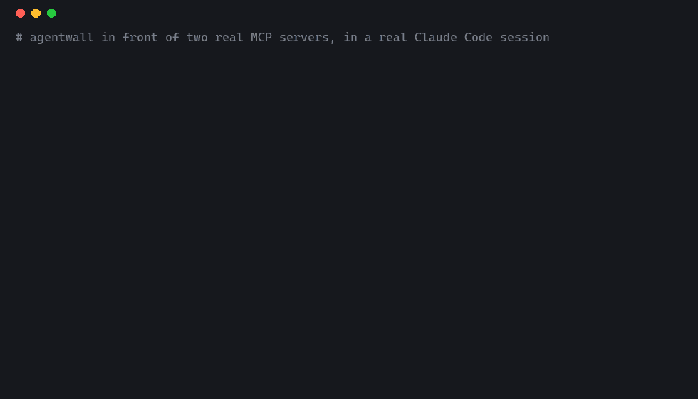
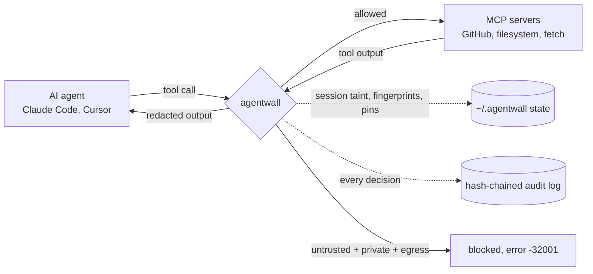

# agentwall

[](https://github.com/Arsh624/agentwall/actions/workflows/ci.yml)
[](https://github.com/Arsh624/agentwall/releases)
[](go.mod)
[](LICENSE)

A local firewall for AI agents. Your agent never sees a real secret, and data it read from strangers can't leak your private data.

agentwall sits between an AI agent (Claude Code, Cursor) and the MCP servers it uses. MCP (Model Context Protocol) is the way agents call tools such as "read a file" or "open a pull request". agentwall runs on your machine as one binary, checks every tool call and every tool answer, and blocks the calls that would leak data.

It is for people who run AI agents with MCP servers on their own computer, and who want the agent to read private data without that data being sent out by a prompt-injected tool call.

**At a glance**

- Blocks 5 of 5 scripted attacks in the bundled suite, with 0 false positives on 4 normal sessions. You can rerun it with `agentwall attack`.
- Adds about 0.2 ms at p99 per tool call for 1 KB payloads (0.5 ms for 10 KB), well under the 2 ms target. See [Benchmarks](#benchmarks).
- One Go binary for Linux, macOS and Windows. Works with stdio and HTTP MCP servers.
- Covers the GitHub MCP "lethal trifecta" heist, secret exfiltration through fetch, poisoned and shadowing tool descriptions, tool rug pulls, terminal escape tricks, zero-width injection and cross-session leaks of private text.

## Demo



This is real output, replayed: one Claude Code session (Haiku, Windows) with the filesystem and fetch servers, each behind `agentwall wrap`, then `agentwall attack`. The prompt and long lines are shortened. `scripts/demo/make_gif.py` renders it.

Text version of the demo, a copy of the GitHub heist scenario in `attacks/github-heist.json`:

1. The agent reads a public issue. The issue text tells the agent to copy a private repo into a pull request. The session is now marked untrusted.
2. The agent reads a file from the private repo. The session is now marked private too.
3. The agent calls `create_pull_request`. agentwall blocks the call and returns this error to the agent (JSON-RPC error code -32001):

```
agentwall blocked this call: lethal trifecta: this session has read untrusted content and private data, so a tool that sends data out is not allowed
```

## The problem

An agent that can read private data, read untrusted content, and send data out has what is called the lethal trifecta (a term from Simon Willison). Each part is normal. Together they let anyone who can write text the agent reads steer the agent into leaking your data. The real-world case named in the project spec is the GitHub MCP data heist (2025): one poisoned GitHub issue made an agent copy a private repository into a public pull request. The third part, a tool that sends data out, is what turns it into a leak. agentwall tracks what the agent has read in each session and blocks the third part when the first two are both present.



## What it does

- **Flow control.** Each tool in the policy is tagged `untrusted_source`, `private_source` or `egress_sink`. A session that has read untrusted content and private data cannot call an egress tool. This works across all the MCP servers of one agent.
- **Fingerprints of private text.** Text from private tool outputs is hashed in 8-word windows. An egress call whose arguments contain that text is blocked, even in a later session.
- **Credential broker.** Secrets are stored in agentwall's vault (the OS keychain, or an encrypted file). They are passed only to the MCP server's environment or HTTP headers, so the agent's config holds no secret. Secret-looking text in tool output is replaced with `[REDACTED:<name>]` before the agent sees it.
- **Tool pinning.** agentwall hashes each tool's whole definition the first time it sees it. If the definition changes later (a rug pull, where a tool quietly changes what it does), the tool is hidden until you run `agentwall approve`.
- **Poisoned and shadowing tools.** A tool is not trusted on first sight if its description reads like an injection (it tells the model to hide something from the user, uses `<IMPORTANT>`-style tags, or names files such as `~/.ssh/id_rsa` or `mcp.json`), or if it gives orders about another server's tool. It stays hidden until you approve it. The 43 tools of the official filesystem, fetch and github servers all pass.
- **Terminal escape codes stripped.** Escape sequences that hide or rewrite text in a terminal are removed from tool output and logged.
- **Policy file.** One YAML file sets tags, `allow` / `deny` / `ask` per tool, argument rules, the hosts an egress tool may reach (`allowed_hosts`), and the environment for each server.
- **Signed audit log.** Every decision is written to a JSONL file. Each entry includes a hash of the previous entry and an HMAC under a key kept in the vault. `agentwall verify` detects edits, deletions, reordering and rebuilt chains.
- **Approval inside the agent.** A tool with `action: ask` (or `on_trifecta: ask`) puts a yes/no question in front of you in Claude Code through MCP elicitation, with the reason and the arguments. With MCP 2026-07-28 clients (current Claude Code) the question is an `input_required` reply and the client retries the call with your answer; agentwall signs the question so a yes only counts for that exact tool and arguments, for 5 minutes. Older clients get an `elicitation/create` request over stdio. Agents without elicitation fall back to the terminal; no answer in 5 minutes means no.
- **Injection heuristics.** Pattern checks look for text such as "ignore previous instructions" and hidden zero-width characters in tool output. A match marks the session untrusted. It never blocks a call by itself.
- **Attack suite.** `agentwall attack` replays scripted attacks and harmless control runs against mock servers, so you can check the firewall yourself.

## Install

In Claude Code, the easiest way is the plugin. Add it and run its setup:

```
/plugin marketplace add Arsh624/agentwall
/plugin install agentwall@agentwall
/agentwall:setup
```

`/agentwall:setup` installs the binary if it is missing (checksum verified), writes the policy, and puts every MCP server of your project behind agentwall, backing up each config it changes. From then on, each session starts with a quick check that warns Claude when a server is not protected. Claude Code 2.1.275 and later can add and install in one step: `/plugin install agentwall --marketplace Arsh624/agentwall`.

Or install the binary yourself. Pick one:

- With Go: `go install github.com/Arsh624/agentwall/cmd/agentwall@latest`
- Install script (Linux and macOS). It downloads the release and verifies its checksum: `curl -fsSL https://raw.githubusercontent.com/Arsh624/agentwall/main/install.sh | sh`
- Binary: download it from the Releases page on GitHub.

Each [release](https://github.com/Arsh624/agentwall/releases) has binaries for Linux, macOS and Windows (amd64 and arm64) and a `checksums.txt` file. The Windows amd64 binary of each release was run by hand, and the install script was run on Linux (Ubuntu under WSL) for v0.1.1; both passed the attack suite. The macOS and arm64 binaries are built by the release workflow but have not been run by hand.

## Quick start

1. Write the default policy and put your agent's MCP servers behind agentwall:

   ```
   agentwall init
   agentwall init --apply
   ```

   `init` writes `~/.agentwall/policy.yaml` (only if the file does not exist) and creates the key that signs the audit log. `init --apply` rewrites `.mcp.json`, `.cursor/mcp.json`, `~/.cursor/mcp.json` and the user's and this project's servers in `~/.claude.json`, so each stdio server starts through agentwall. It backs up every file it changes, and a second run changes nothing. `agentwall init --check` lists any server that is still not protected. Restart the agent afterwards.

2. Or do it by hand. In `.mcp.json`, change this:

   ```json
   {
     "mcpServers": {
       "github": {
         "command": "npx",
         "args": ["-y", "@modelcontextprotocol/server-github"]
       }
     }
   }
   ```

   to this:

   ```json
   {
     "mcpServers": {
       "github": {
         "command": "agentwall",
         "args": ["wrap", "--", "npx", "-y", "@modelcontextprotocol/server-github"]
       }
     }
   }
   ```

3. Move the token out of the agent config and into the vault. The value is read from stdin, not from the command line:

   ```
   printf '%s\n' "$GITHUB_PERSONAL_ACCESS_TOKEN" | agentwall secret set github
   ```

   Then add this to `~/.agentwall/policy.yaml`, so the server gets the token from the vault:

   ```yaml
   servers:
     github:
       env:
         GITHUB_PERSONAL_ACCESS_TOKEN: "vault:github"
   ```

   Remove the token from your agent config yourself. agentwall does not edit it.

4. Use the agent as usual. Then check what happened:

   ```
   agentwall log
   agentwall verify
   agentwall attack
   ```

- When a tool's definition changes, its calls are blocked and the error tells you the command to run. Accept the change with `agentwall approve <server>/<tool>`.
- For an HTTP MCP server, run `agentwall proxy --upstream URL` and point the agent at the address set by `--listen` (default `127.0.0.1:7878`).

## Policy

The policy is one YAML file. Here is an annotated example. Most keys are optional.

```yaml
# What happens to a tool call that no tool rule covers: allow, deny or ask.
default_action: allow

# What happens to an egress call when the session has read both untrusted and
# private data (on_trifecta), or when its arguments contain private text (on_fingerprint).
# deny blocks the call. ask asks you: in the agent when it supports MCP elicitation
# (Claude Code does), otherwise on the terminal; no answer in 5 minutes is a no.
on_trifecta: deny
on_fingerprint: deny

servers:
  github:                              # the name the policy uses for this server
    tools:
      get_issue:
        tags: [untrusted_source]       # text here is written by strangers
      get_file_contents:
        tags: [private_source]         # text here may be your private data
      create_pull_request:
        tags: [egress_sink]            # this call sends data out
    env:
      GITHUB_PERSONAL_ACCESS_TOKEN: "vault:github"   # filled from the vault, for this server only

  filesystem:
    tools:
      read_file:
        tags: [private_source]
        deny_args:
          path: '\.env$'               # deny the call when this argument matches the regexp
      write_file:
        action: ask                    # ask you before each call

  fetch:
    tools:
      fetch:
        tags: [untrusted_source, egress_sink]
        allowed_hosts: [docs.python.org, github.com]   # any other host in a URL argument is denied; subdomains count
```

The three tags:

- `untrusted_source`: the output can be written by people outside your control, such as issues or web pages.
- `private_source`: the output can contain your private data, such as repo files or local files.
- `egress_sink`: the call can send data out, such as posting a comment, opening a pull request or fetching a URL.

The policy file is `~/.agentwall/policy.yaml`. To use another file, pass `--policy FILE` to `wrap` or `proxy`. If there is no policy file, agentwall uses the built-in policy, which tags tools of the github, filesystem, fetch and slack servers.

## Attack suite

The suite replays nine attacks and six harmless runs through the real proxy and firewall:

```
SCENARIO                   KIND    RESULT
ansi-escape                attack  blocked
benign-allowed-host        benign  allowed
benign-issue-triage        benign  allowed
benign-private-coding      benign  allowed
benign-real-tool-lists     benign  allowed
benign-stable-tools        benign  allowed
benign-web-research        benign  allowed
egress-allowlist           attack  blocked
fingerprint-cross-session  attack  blocked
github-heist               attack  blocked
rug-pull                   attack  blocked
secret-exfil-fetch         attack  blocked
tool-poisoning             attack  blocked
tool-shadowing             attack  blocked
zero-width-injection       attack  blocked

blocked 9/9 attacks, false positives 0/6
```

CI runs the suite on Linux, Windows and macOS.

## Formal verification

Two parts of the design are model-checked with TLA+ and the TLC model checker. The specs are in [spec/](spec), and CI checks them on every pull request.

- [spec/Trifecta.tla](spec/Trifecta.tla): one agentwall process per MCP server, sharing taint through files, with answers and calls interleaving in any order. TLC checks that no egress call goes out once the agent has seen both untrusted and private data, over all 108 reachable states. A broken variant that hands an answer to the agent before recording its taint must fail, and TLC finds the 6-step leak.
- [spec/Ask.tla](spec/Ask.tla): the approval question, where your answer, the 5-minute timeout and the agent cancelling the call race each other. TLC checks that a call reaches the server only after you accepted it, that the agent never gets two replies to one call, that a cancelled call is never forwarded, and that every question ends (169 states, two calls in flight). It was written before the Go code. A variant whose timeout leaves the question open must fail.

The models check the design, not the Go code; the Go tests check that the code follows it. To run them: `sh spec/check.sh path/to/tla2tools.jar` (TLA+ tools v1.7.4, Java 11 or later).

## Benchmarks

| case | direct p50 | direct p99 | wrapped p50 | wrapped p99 | added p50 | added p99 |
|---|---|---|---|---|---|---|
| echo 1 KB | 15 µs | 58 µs | 80 µs | 287 µs | 65 µs | 229 µs |
| private read 1 KB | 13 µs | 42 µs | 80 µs | 258 µs | 67 µs | 216 µs |
| echo 10 KB | 48 µs | 202 µs | 296 µs | 693 µs | 248 µs | 490 µs |

Machine: Intel Core Ultra 7 255H, 16 cores, 31.4 GB RAM, Windows 11 Home 10.0.26200, go1.27.3 windows/amd64, 2026-11-16

```
target: added p99 < 2000 µs — met
```

Full method and in-process numbers: [docs/BENCHMARKS.md](docs/BENCHMARKS.md)

## Threat model

### What it is meant to stop

- An agent that has read untrusted content and then sends private data out through an egress tool, in one session or across MCP servers of one agent.
- Private text that is pasted into an egress call, including in a later session.
- Secrets appearing in tool output, and secrets sitting in the agent's config.
- A tool whose definition changed after you accepted it, and a new tool whose description is poisoned or gives orders about another server's tool.
- Terminal escape codes in tool output.
- An egress tool reaching a host outside its `allowed_hosts`.
- Prompt-injection text in tool output. It marks the session untrusted, so the flow rules apply.
- Edits, deletions and reordering of audit entries, and a chain rebuilt by someone without the audit key (`agentwall verify` detects them).

### What it does not stop

- Fingerprints miss secrets shorter than 8 words, and text that was re-encoded (for example in base64).
- Vault values shorter than 8 characters are stored but not redacted.
- A vault secret is caught as written, percent-encoded, or inside base64 (for example a Basic auth header). Other encodings (hex, compression, a secret split across fields) are not.
- Without a keychain and without `AGENTWALL_PASSPHRASE`, `wrap` runs with pattern-only redaction. It prints a warning.
- The audit log cannot show that its newest entries were removed. A log written without a vault (or before v0.2) is unsigned; `verify` counts those entries and says so.
- The poisoning scan is pattern matching on the description. A tool can still be written to evade it; the flow rules then still apply. Shadowing is only checked for tool names that contain `_` or `-`.
- `allowed_hosts` checks `http(s)://` URLs inside string arguments. A host passed as a bare string is not checked.
- Server notifications and requests (logs, progress, elicitation, roots) are redacted but not tainted. Sampling requests are refused. Over HTTP a refused request gets no answer, so the server waits for one.
- A tool that the policy does not tag gets no flow control.
- In HTTP mode, a client older than MCP 2026-07-28 gets no for an `ask`: agentwall can only ask it over stdio. Agents that do not support MCP elicitation get the terminal prompt.
- Taint is shared between the MCP servers of one agent by the agent's process id (on Windows, agentwall looks past `cmd /c` and PowerShell wrappers). This was checked with a real Claude Code session on Windows (2.1.177, filesystem and fetch servers): both servers shared one session, and the second fetch was blocked as a lethal trifecta. If your servers still get different ids, set the same `AGENTWALL_SESSION` in each server's `env`.
- The injection heuristics are pattern matching. They can be evaded.
- The fingerprint rule blocks writing an edited private file back through an egress tool (for example, reading a file and then committing it with `create_or_update_file`). Set `on_fingerprint: ask` to be asked instead, or remove the `egress_sink` tag from that tool. This is on purpose: the firewall cannot tell your own repository from someone else's.
- Anyone with access to your user account can read `~/.agentwall`.

## How it compares

> This is the author's reading of other projects' public documentation when agentwall was started. Check their docs before relying on it.
>
> - **MCP gateways** (Docker MCP Gateway, Kong's MCP support, Obot, TrueFoundry) focus on routing, authentication and logging for many servers and teams. As far as we know they do not track where data came from or stop a session that has read both untrusted and private data from sending data out. If you need a team gateway, use one of them; agentwall can sit in front of a single server next to them.
> - **Small open-source guards** (for example guardbee and Interlock) cover parts of this problem. We have not compared them feature by feature and make no claim that agentwall is better.
> - **What agentwall adds** in one local binary: information-flow control, fingerprinting of private text, credential isolation, tool pinning, a tamper-evident log, and a public attack suite you can run yourself.
> - **What agentwall does not have:** a web dashboard, multi-user access control, a hosted service, an ML classifier, OPA/Cedar policies.

## Commands

| Command | What it does |
|---|---|
| `agentwall init` | Write the default policy and the audit key, and show how to wrap your Claude Code / Cursor servers |
| `agentwall init --apply` | Rewrite the agent configs so every stdio MCP server runs through agentwall (backs each file up) |
| `agentwall init --check` | List the MCP servers that do not go through agentwall (prints nothing when all do) |
| `agentwall wrap [--policy file] [--server name] -- <cmd> [args...]` | Run an MCP server behind the firewall (stdio) |
| `agentwall proxy --upstream URL [--listen addr] [--server name] [--policy file]` | Run the firewall in front of an HTTP MCP server |
| `agentwall secret set NAME` | Store a secret in the vault (the value is read from stdin) |
| `agentwall secret list` | List the names of the stored secrets |
| `agentwall approve <server>/<tool>` | Accept a changed tool |
| `agentwall verify` | Check the audit log hash chain and its signatures |
| `agentwall log [--tail]` | Pretty-print the audit log; `--tail` keeps printing new entries |
| `agentwall attack` | Run the attack suite and print the score |

## Status

v0.3. The firewall and its tests run on Linux, Windows and macOS in CI, and it was checked in real Claude Code sessions on Windows, including the plugin's `/agentwall:setup`. In a real Claude Code 2.1.327 session the `input_required` question round trip works (print mode answers it with cancel, which agentwall turns into a deny). Not yet verified: a real remote HTTP MCP server, and the question as it appears in Claude Code's interactive screen.

State lives in `~/.agentwall/`:

- `policy.yaml`: the policy file written by `init`.
- `audit.jsonl`: the audit log. Its signing key is the vault secret `audit-key`, created by `init`.
- `pins/`: one file per server with the accepted tool hashes.
- `sessions/`, `fingerprints`: taint markers and fingerprints shared by the processes of one agent.
- `vault.enc`: the encrypted vault, only when the passphrase backend is used.

Environment variables:

- `AGENTWALL_HOME`: use another state directory instead of `~/.agentwall`.
- `AGENTWALL_PASSPHRASE`: store secrets in an AES-256-GCM file instead of the OS keychain. The key is derived from this passphrase with PBKDF2.
- `AGENTWALL_SESSION`: set the session id yourself instead of using the parent process id.

For the design, see [docs/ARCHITECTURE.md](docs/ARCHITECTURE.md). For the goals and the reasoning, see [docs/SPEC.md](docs/SPEC.md).

## How this was built

I picked the problem, wrote the threat model and the design ([docs/SPEC.md](docs/SPEC.md), [docs/PLAN.md](docs/PLAN.md)), and split the work into milestones. Most of the code was written with Claude Code working through that plan, test first, one milestone per pull request. I reviewed the results, ran the attack suite and benchmarks, and tested it in a real Claude Code session. The prompts are in [docs/PROMPTS.md](docs/PROMPTS.md).

## License

MIT. See [LICENSE](LICENSE).
